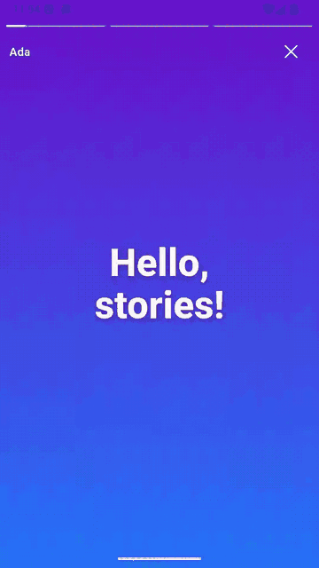
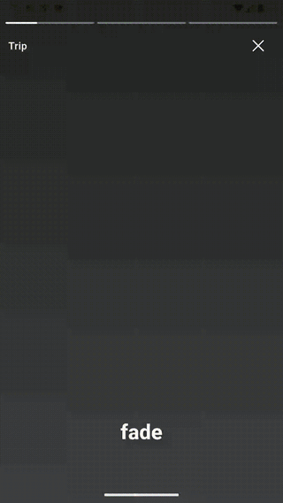
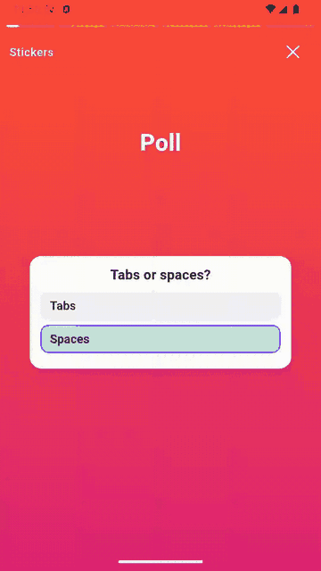
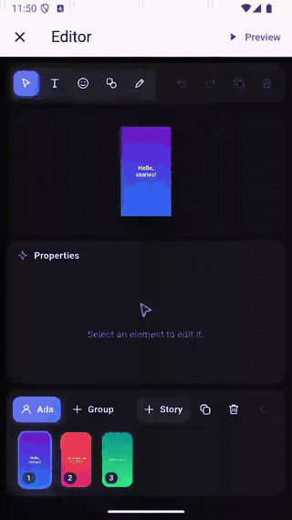
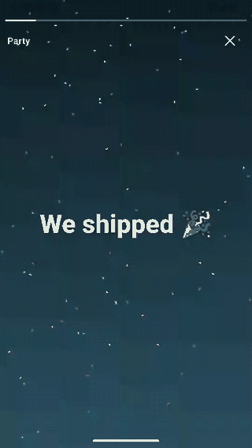
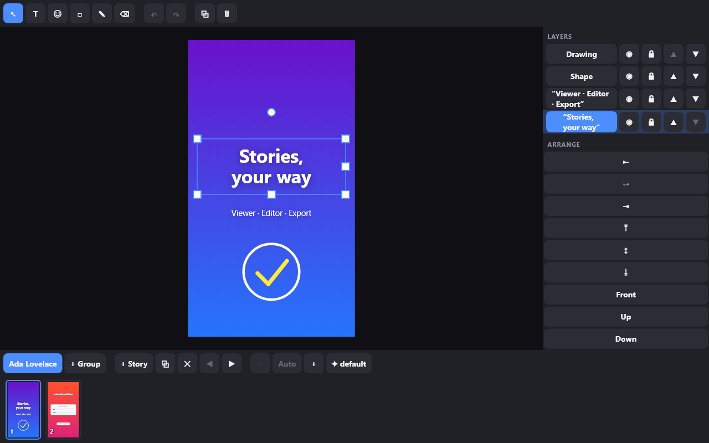

# Story Framework

Instagram-style stories for Flutter: a customizable **viewer**, a full
**editor**, **interactive stickers**, **video and audio**, and **export**. It is
built on one shared document model and has **no third-party runtime
dependencies**.

<table>
  <tr>
    <td align="center"><br><sub>Basic story</sub></td>
    <td align="center"><br><sub>Images and transitions</sub></td>
    <td align="center"><br><sub>Interactive stickers</sub></td>
    <td align="center"><br><sub>Story editor</sub></td>
    <td align="center"><br><sub>Custom renderer</sub></td>
  </tr>
</table>



## Features

- **Viewer**:
  - Segmented progress, tap, hold, swipe, and keyboard navigation.
  - Swipe down to dismiss; cube, fade, slide, zoom and other transitions.
  - Overlays, loading and error states, and fullscreen or inline layout.
  - Every part can be replaced.
- **Editor**:
  - Move, scale, and rotate with snapping and alignment guides.
  - Text, sticker, shape, draw, and eraser tools.
  - Layers, a timeline, and undo/redo with transactions.
  - Keyboard shortcuts and accessible panels.
- **Stickers from any source**:
  - Emoji, image (animated GIF and WebP), and provider stickers.
  - Plug in Giphy, Tenor, your own packs, or a custom renderer.
- **Interactive content**:
  - Polls, quizzes, questions, sliders, countdowns, links, and product tags.
  - Every interaction is reported to your app.
- **Video and audio with any player**:
  - Adapters are a few dozen lines; `video_player` and `just_audio` versions
    are in the example.
  - Synced companion media and next-item preloading.
  - A memory byte cache.
- **Export**:
  - Export the document as JSON, each item as a PNG, or a slideshow video
    through your own encoder.
- **Headless engine**:
  - `StoryController` runs a drift-free timeline with no UI.
  - Use it to build a completely custom viewer.
- **Versioned JSON**:
  - Migrations and validation.
  - Unknown element types from newer versions are preserved, not dropped.

## Install

```yaml
dependencies:
  story_framework: ^0.1.0
```

Import everything with `package:story_framework/story_framework.dart`, or only
the part you use (see [entry points](#entry-points)).

## Examples, from basic to advanced

### 1. Show a story

[See it in action](https://raw.githubusercontent.com/ChristianLloydSalon/story_framework/main/doc/demos/01_basic_story.gif)

```dart
import 'package:flutter/material.dart';
import 'package:story_framework/story_framework.dart';

final document = StoryDocument(
  id: 'demo',
  groups: [
    StoryGroup(id: 'ada', title: 'Ada', items: [
      StoryItem(
        id: 'hello',
        background: StoryGradientBackground(colors: const [
          StoryColor(0xFF6A11CB),
          StoryColor(0xFF2575FC),
        ]),
        elements: [
          TextElement(
            id: 'title',
            // Canvas units: the default canvas is 1080×1920.
            transform: const StoryTransform(
              position: StoryPoint(540, 960),
              size: StorySize(900, 300),
            ),
            text: 'Hello, stories!',
            style: StoryTextStyle(fontSize: 110, fontWeight: 800),
          ),
        ],
      ),
    ]),
  ],
);

class StoryPage extends StatelessWidget {
  const StoryPage({super.key});

  @override
  Widget build(BuildContext context) => StoryViewer(
        document: document,
        onDismiss: () => Navigator.pop(context),
        onComplete: () => Navigator.pop(context),
      );
}
```

Tap right to go forward and left to go back. Hold to pause, swipe sideways to
change groups, and swipe down to dismiss.

### 2. Images, durations, and transitions

[See it in action](https://raw.githubusercontent.com/ChristianLloydSalon/story_framework/main/doc/demos/02_images_and_transitions.gif)

```dart
StoryItem(
  id: 'beach',
  duration: const FixedItemDuration(Duration(seconds: 8)),
  transition: const StoryTransitionConfiguration.preset('fade'),
  elements: [
    ImageElement(
      id: 'photo',
      transform: const StoryTransform(
        position: StoryPoint(540, 960),
        size: StorySize(1080, 1920),
      ),
      source: NetworkStorySource(Uri.parse('https://example.com/beach.jpg')),
      semanticLabel: 'Sunset over the beach',
    ),
  ],
)
```

The viewer prefetches the next item's images. Presets are `none`, `fade`,
`slide`, `scale`, `zoom`, `cube`, and `reveal`. Users who ask for reduced
motion get a short fade automatically.

### 3. Configure and customize the viewer

```dart
StoryViewer(
  document: document,
  config: const StoryViewerConfig(
    previousTapFraction: 0.25,
    groupTransition: StoryTransitionConfiguration.preset('cube'),
  ),
  playbackConfig: const StoryPlaybackConfig(
    defaultItemDuration: Duration(seconds: 6),
  ),
  footerBuilder: (context, controller) => const ReplyBar(),
  overlays: [
    StoryOverlay(
      id: 'paused',
      alignment: AlignmentDirectional.center,
      interactive: false,
      visibleWhen: (state) =>
          state.pauseReasons.contains(StoryPauseReason.user),
      builder: (context, controller) => const PausedBadge(),
    ),
  ],
)
```

The header, footer, progress bar, and loading and error states each have a
builder. `layoutBuilder` replaces the whole layout. Gestures and transitions
use registries, so you can add your own (see the
[gesture](doc/GESTURE_SYSTEM.md) and [transition](doc/TRANSITION_SYSTEM.md)
guides).

### 4. Interactive stickers

[See it in action](https://raw.githubusercontent.com/ChristianLloydSalon/story_framework/main/doc/demos/04_interactive_stickers.gif)

```dart
InteractiveElement(
  id: 'poll',
  transform: const StoryTransform(
    position: StoryPoint(540, 1200),
    size: StorySize(880, 560),
  ),
  interaction: StoryPoll(question: 'Tabs or spaces?', choices: const [
    StoryChoice(id: 'tabs', label: 'Tabs'),
    StoryChoice(id: 'spaces', label: 'Spaces'),
  ]),
)
```

```dart
StoryViewer(
  document: document,
  onInteraction: (event) => switch (event) {
    StoryChoiceSelectedEvent(:final choiceId) => api.vote(choiceId),
    StoryLinkTappedEvent(:final url) => launchUrl(url),
    StoryQuestionRepliedEvent(:final text) => api.reply(text),
    _ => null,
  },
)
```

Stickers never trigger navigation, and they work with screen readers and the
keyboard. To show saved votes or results, pass a
`StoryInteractionController(initialStates: ...)`.

### 5. Video and audio with your own player

story_framework doesn't depend on any player. Copy an adapter from
[`example/lib/media/`](example/lib/media/) into your app (`video_player` and
`just_audio` are ready to use), or write one for any player:

```dart
StoryViewer(
  document: document,
  mediaFactories: const [
    VideoPlayerStoryMediaFactory(),
    JustAudioStoryMediaFactory(),
  ],
)
```

```dart
StoryItem(
  id: 'clip',
  duration: const MediaItemDuration(elementId: 'video'),
  elements: [
    VideoElement(
      id: 'video',
      transform: const StoryTransform(
        position: StoryPoint(540, 960),
        size: StorySize(1080, 1920),
      ),
      source: NetworkStorySource(Uri.parse('https://example.com/clip.mp4')),
      poster: NetworkStorySource(Uri.parse('https://example.com/clip.jpg')),
    ),
    AudioElement(id: 'music', source: const AssetStorySource('assets/song.mp3')),
  ],
)
```

The item lasts as long as its video. Other media on the item plays in sync
with the timeline. The next item's media is preloaded. See the
[media guide](doc/MEDIA_SYSTEM.md).

Images can use a shared, memory-bounded byte cache:

```dart
final loader = StoryResourceLoader(
  fetcher: createStoryHttpFetcher(),
  cache: MemoryStoryCache(maxBytes: 32 * 1024 * 1024),
);

StoryViewer(
  document: document,
  renderOptions: StoryRenderOptions(
    imageResolver: DefaultStoryImageResolver(networkLoader: loader),
  ),
)
```

### 6. The story editor

[See it in action](https://raw.githubusercontent.com/ChristianLloydSalon/story_framework/main/doc/demos/06_story_editor.gif)

```dart
import 'package:story_framework/editor.dart';

StoryEditor(
  document: draft,
  onChanged: (document) => saveDraft(document),
)
```

The editor UI is ready to use. To build your own UI, use the pieces directly:

```dart
final editor = StoryEditorController(document: draft);

editor.select(['title']);
editor.nudgeSelection(10, 0);           // one undoable command
editor.runTransaction('Restyle', () {      // many edits, one undo step
  editor.nudgeSelection(0, 20);
  editor.duplicateSelection();
});
editor.undo();

StoryEditorCanvas(controller: editor);  // canvas, handles, and snapping only
```

The image and video tools call your own pickers. You can register custom
tools with `StoryEditorToolRegistry`. See the
[editor guide](doc/EDITOR_SYSTEM.md).

### 7. Save, load, and validate

```dart
const codec = StoryDocumentCodec();
final json = codec.encodeToString(document);   // versioned JSON
final restored = codec.decodeFromString(json); // older versions migrate

final report = const StoryDocumentValidator().validate(restored);
for (final issue in report.issues) {
  print('${issue.severity} ${issue.code} at ${issue.path}: ${issue.message}');
}
```

### 8. Export

```dart
import 'package:story_framework/export.dart';

final exporters = StoryExporterRegistry([
  const StoryDocumentExporter(),     // .story.json
  StoryPngExporter(),                // one PNG per item
  StoryVideoExporter(MyFfmpegEncoder()), // your encoder
]);

final job = exporters.export(
  document,
  const StoryExportConfig(format: StoryExportFormat.png, width: 1080),
);
job.progress.addListener(() => print(job.progress.value));
final result = await job.result; // job.cancel() stops it
for (final file in result.outputs) {
  await File(file.name).writeAsBytes(file.bytes);
}
```

Items are rendered offscreen with the same renderers the viewer uses. Images
are loaded before capture. Video export holds each item's frame for its
duration and gives the item's audio to your `StoryVideoEncoder`. See the
[export guide](doc/EXPORT_SYSTEM.md).

### 9. Headless playback for a custom viewer

```dart
import 'package:story_framework/engine.dart';

final controller = StoryController(document: document);
final item = controller.select((state) => state.itemIndex);
item.addListener(() => print('Now on item ${item.value}'));

controller.play();
controller.next();
final hold = controller.acquirePause(StoryPauseReason.interaction);
hold.release();
await controller.dispose();
```

Pass the controller to `StoryViewer.controller(...)`, or build your own UI on
it. Pause reasons are tracked separately, so a held overlay and an app going
to the background never resume each other.

### 10. Custom elements and renderers

[See it in action](https://raw.githubusercontent.com/ChristianLloydSalon/story_framework/main/doc/demos/10_custom_renderer.gif)

```dart
final class ConfettiRenderer extends StoryElementRenderer<CustomElement> {
  @override
  String get id => 'confetti';

  @override
  bool supports(StoryElement element) =>
      element is CustomElement && element.customType == 'confetti';

  @override
  Widget buildElement(BuildContext context, CustomElement element,
          StoryRenderContext renderContext) =>
      Confetti(seed: element.data['seed'] as int? ?? 0);
}

final renderers = StoryRendererRegistry.withDefaults([ConfettiRenderer()]);
StoryViewer(document: document, registry: renderers);
```

Pass the same registry to the editor and the exporters so a custom element
looks the same everywhere. See the [rendering guide](doc/RENDERING_SYSTEM.md).

## Stickers, GIFs, and emojis from any source

Sticker content isn't tied to a provider. GIFs, emojis, and stickers can come
from Giphy, Tenor, your own server, a bundled pack, or anything else. There
are three ways to plug in a source.

**Image stickers from any URL, GIFs included.** Flutter plays animated GIF
and WebP images, so any host works. Assets, files, and in-memory bytes work
too, and images share the viewer's cache.

```dart
StickerElement(
  id: 'party',
  transform: const StoryTransform(
    position: StoryPoint(540, 960),
    size: StorySize(400, 400),
  ),
  sticker: ImageSticker(
    NetworkStorySource(Uri.parse('https://media.giphy.com/media/<id>/giphy.gif')),
    animated: true,
  ),
)
```

**Your own source type, resolved when drawn.** Store a stable id instead of
a URL, for example when URLs expire or need an API key:

```dart
ImageSticker(CustomStorySource('giphy', data: {'id': 'xT9IgG50Fb7Mi0prBC'}))

final options = StoryRenderOptions(
  imageResolver: DefaultStoryImageResolver(customResolvers: {
    'giphy': (source) => NetworkImage(giphyUrlFor(source.data['id'])),
  }),
);
// Pass `options` as `renderOptions` to StoryViewer and StoryEditor.
```

**Provider stickers drawn by your own widget,** for anything that isn't a
plain image (Lottie, branded packs, another emoji set):

```dart
CustomSticker(providerId: 'lottie', stickerId: 'confetti')

// Replaces the built-in sticker renderer; emoji and image stickers still work.
final renderers = StoryRendererRegistry.withDefaults()
  ..replace(StoryStickerRenderer(customBuilders: {
    'lottie': (context, sticker, element, renderContext) =>
        MyLottieSticker(id: sticker.stickerId),
  }));
// Pass `renderers` as `registry` to StoryViewer and as `renderers` to
// StoryEditor and the exporters.
```

**Emojis.** `EmojiSticker('🔥')` uses the device's emoji font, so it looks
different on each platform. For the same look everywhere, use emoji images
(for example Twemoji or Noto) as `ImageSticker`s or a `CustomSticker` pack.

**Picking stickers in the editor.** Give the sticker tool your own picker,
such as a Giphy or Tenor search sheet or your sticker packs. It returns the
chosen `StickerContent`, or `null` if cancelled. Without a picker, the tool
adds a ⭐.

```dart
StoryEditor(
  document: draft,
  stickerPicker: () => showStickerSheet(context),
)
```

Notes:

- PNG and video export capture one frame, so an animated GIF exports as a
  still image.
- Giphy and Tenor require their own API and attribution ("Powered by
  GIPHY"). That integration belongs in your app; the package has no
  dependency on either.

## Entry points

| Import | Contents |
|---|---|
| `package:story_framework/story_framework.dart` | Everything public |
| `package:story_framework/composition.dart` | Documents, elements, serialization, validation (no widgets) |
| `package:story_framework/media.dart` | Media contracts, cache, resource loader |
| `package:story_framework/engine.dart` | Headless playback controller |
| `package:story_framework/rendering.dart` | Renderers, registry, and item views |
| `package:story_framework/viewer.dart` | The story viewer, gestures, and overlays |
| `package:story_framework/animations.dart` | Story transitions |
| `package:story_framework/editor.dart` | The story editor |
| `package:story_framework/export.dart` | JSON, PNG, and video export |

## Example app

Each of the ten examples above can be run on its own from
[`example/lib/examples/`](example/lib/examples/):

```bash
cd example
flutter create . --platforms=android,ios,web
flutter run                                          # gallery of all examples
flutter run -t lib/examples/04_interactive_stickers/main.dart
```

## Documentation

- [Architecture](doc/ARCHITECTURE.md) and [API conventions](doc/API_DESIGN.md)
- [Domain model](doc/DOMAIN_MODEL.md) and
  [serialization and validation](doc/COMPOSITION_SYSTEM.md)
- [Playback engine](doc/PLAYBACK_ENGINE.md)
- [Rendering](doc/RENDERING_SYSTEM.md)
- [Viewer](doc/VIEWER_SYSTEM.md), [gestures](doc/GESTURE_SYSTEM.md),
  [transitions](doc/TRANSITION_SYSTEM.md), and [overlays](doc/OVERLAY_SYSTEM.md)
- [Interactive content](doc/INTERACTIVE_CONTENT.md)
- [Media](doc/MEDIA_SYSTEM.md)
- [Editor](doc/EDITOR_SYSTEM.md)
- [Export](doc/EXPORT_SYSTEM.md)
- [Contributing](CONTRIBUTING.md)

## License

See [LICENSE](LICENSE).
